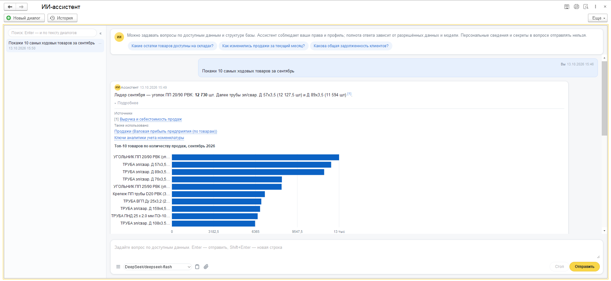
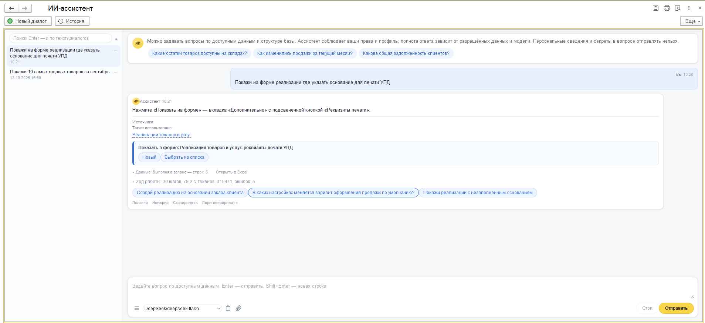
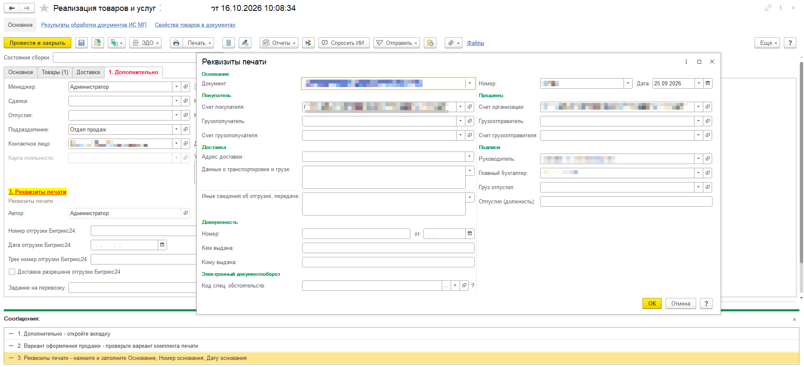
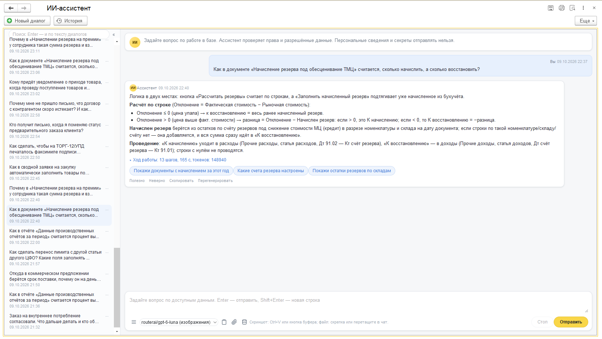

# Расширение «ИИ-ассистент» (ИИАссистент)

Чат с ИИ-ассистентом по данным информационной базы ERP. Ассистент отвечает на вопросы, строит запросы и отчёты, рисует графики, открывает объекты, предлагает черновики документов и изменения данных, которые записывает только сам пользователь кнопкой «Выполнить». Работает в пределах прав пользователя, профиля доступа и жёсткого периметра данных, заданного в коде.

Версия расширения и поставляемых данных: `0.2.0.7`. Префикс объектов: `ИИА_`.

Содержание:

1. [Быстрый старт](#1-быстрый-старт)
2. [Роли и доступ](#2-роли-и-доступ)
3. [Чат](#3-чат)
4. [Настройки ассистента](#4-настройки-ассистента)
5. [Подключения к моделям](#5-подключения-к-моделям)
6. [Профили доступа](#6-профили-доступа)
7. [Версии политик](#7-версии-политик)
8. [Защита данных: периметр, классы, доверие, маскирование](#8-защита-данных)
9. [Внешний доступ (HTTP API)](#9-внешний-доступ-http-api)
10. [Где что хранится](#10-где-что-хранится)
11. [Поставляемые данные и обновление](#11-поставляемые-данные-и-обновление)
12. [Обслуживание и лимиты](#12-обслуживание-и-лимиты)

---

## Скриншоты

**Отчёт с графиком по данным базы**



**«Показать на форме»: ассистент находит нужное поле в документе**





**Объяснение логики документа по коду конфигурации**



## Состав репозитория

| Путь | Что это |
|---|---|
| `dist/ИИАссистент.cfe` | Готовое расширение, собрано в 1С:ERP 2.5.27, платформа 8.3.27 |
| `src/ИИАссистент/` | XML-исходники расширения (выгрузка конфигуратора) |
| `tools/cfe_for_config.py` | Подготовка исходников к загрузке в другую типовую конфигурацию |
| `docs/third-party/` | Лицензии сторонних компонентов |

## Установка

Готовые сборки для ERP 2.5 и УТ 11.5 — в [релизах](https://github.com/alonehobo/ai-assistant-1c/releases/latest).

1. Конфигуратор → **Конфигурация → Расширения конфигурации → Добавить из файла** → CFE из релиза для вашей конфигурации (или `dist/ИИАссистент.cfe` для ERP).
   Либо в режиме Предприятия: **Администрирование → Печатные формы, отчёты и обработки → Расширения**.
2. Снимите флаги «Безопасный режим» и «Защита от опасных действий»: расширению нужны HTTP-запросы к моделям.
3. Обновите конфигурацию базы данных и перейдите к [быстрому старту](#1-быстрый-старт).

Для конфигураций других линеек (УНФ и др.) соберите расширение из `src/` по разделу «Типовые конфигурации».

Требования: платформа 8.3.27 и выше, конфигурация на БСП 3.1+.

Сторонний код: модуль `ИИА_HTTPКоннектор` основан на [Connector](https://github.com/vbondarevsky/Connector) (Apache License 2.0), лицензия — `docs/third-party/connector/LICENSE`. Общий макет `ИИА_Mermaid` содержит [Mermaid](https://github.com/mermaid-js/mermaid) (MIT), лицензия — `docs/third-party/mermaid-LICENSE.txt`.

---

## 1. Быстрый старт

1. Назначьте администратору профиль групп доступа **ИИА_Администратор** (поставляется расширением).
2. Откройте раздел **ИИ-ассистент → Настройки ИИ-ассистента**, вкладка **Быстрый запуск**:
   - **Шаг 1.** Нажмите «Подключения к моделям», откройте нужное подключение (шесть провайдеров уже заведены и выключены), введите ключ API, включите «Используется». Вернитесь, выберите подключение и нажмите «Проверить модель».
   - **Шаг 2.** Выберите «Профиль по умолчанию» и при необходимости настройте профили.
   - **Шаг 3.** «Проверить доступ» для нужного пользователя.
   - **Шаг 4.** Включите «Использовать ИИ-ассистента» и нажмите «Сохранить настройки и открыть чат».
3. Пользователям назначьте профиль групп доступа **ИИА_Пользователь**.

Поставляемые справочники (подключения, профили, карточки отчётов, глоссарий) заполняются автоматически при первом открытии чата или настроек после установки или обновления расширения.

### Типовые конфигурации

Расширение работает в ERP, КА, БП, УТ и УНФ: бухгалтерские возможности включаются по составу конфигурации.

| Конфигурация | План счетов ассистента | Бухгалтерские инструменты |
|---|---|---|
| ERP, КА, БП | `Хозрасчетный` | `run_trial_balance`, `run_accounting_report`, `accounting_balances` (с субконто) |
| УНФ | `Управленческий` (фактический сценарий) | `accounting_balances` без субконто |
| УТ, ЗУП | нет | нет; страница «Счета» в профиле и форме «Доступ к данным» скрыта |

Расширение, собранное в ERP или УТ, в УНФ не загружается: платформа сверяет идентификаторы заимствованных объектов и режим совместимости интерфейса. Перед загрузкой в другую линейку подготовьте копию по свежей выгрузке конфигурации базы (`DumpConfigToFiles`, не сохранённые исходники — они могут отставать):

```bash
python tools/cfe_for_config.py src/ИИАссистент <выгрузка конфигурации базы> <каталог копии>
```

---

## 2. Роли и доступ

Роли назначаются через штатные группы доступа БСП; для каждой роли расширение поставляет одноимённый профиль групп доступа.

| Роль | Кому | Что даёт |
|---|---|---|
| **ИИА_Пользователь** | всем, кто пользуется чатом | Форма чата и команда «ИИ-ассистент». Прав на служебные объекты ИИА роль не даёт: диалоги, профиль, подключения, настройки и журналы ход читает и пишет на сервере привилегированно, только свои (отбор по пользователю). Прикладные данные читаются в пределах прав пользователя (RLS) и периметра. |
| **ИИА_Администратор** | администратору ассистента | Форма настроек; полные права на подключения, профили, глоссарий, карточки отчётов; создание и изменение версий политик; изменение классификации данных и режимов инструментов; чтение журнала вызовов, диалогов и черновиков; изменение настроечных констант. |
| **ИИА_Аудитор** | службе безопасности | Чтение журнала вызовов, диалогов, черновиков, классификации, подключений, профилей. Просмотр версий политик. |
| **ИИА_ИсходныйКод** | разработчикам | Разрешает инструменты работы с кодом конфигурации (`code_*`). Дополнительно нужен флаг «Исходный код» в профиле доступа. |
| **ИИА_ВнешнийДоступ** | интеграциям | Выпуск JWT и вызов HTTP-сервиса `/hs/iia`. |

Пользователь с полными правами имеет доступ ко всему.

---

## 3. Чат

### Как открыть

- Команда **«ИИ-ассистент»** в разделе «ИИ-ассистент» (группа «Важное») или **Ctrl+Shift+I**. Повторный вызов активирует уже открытое окно.
- Подменю **«ИИ-ассистент» → «Спросить ИИ»** в формах объектов и списков. Чат открывается с контекстом объекта: ассистент учитывает его в каждом ответе. Новый объект перед этим записывается. Команда показывается, только если ассистент включён, у пользователя есть право на чат и объект не закрыт периметром.

### Командная панель

| Кнопка | Что делает |
|---|---|
| **Новый диалог** | Останавливает текущий ответ, очищает чат и начинает новый диалог. |
| **История** | Показывает или скрывает боковую панель истории (см. ниже). |
| **Настройки** | Открывает настройки ассистента (только для администратора). |
| **Токен API** | Видна только с ролью ИИА_ВнешнийДоступ. Выпускает JWT на 15 минут для внешнего доступа к инструментам. |

Группа «Ввод для автотестов» — служебная, для TestClient.

### Ввод вопроса

- Текст вводится в поле внизу страницы чата; отправка — кнопкой или Enter. Максимум 8000 символов.
- **Изображения** (если разрешены в настройках): до 6 штук, JPEG/PNG до ~1 МБ каждое. Скриншоты **не проверяются** на персональные данные. В историю диалога сохраняется только пометка «[приложено изображений: N]».
- **Файлы с компьютера** (если в настройках не выключено «Разрешить файлы в вопросах»): скрепка или перетаскивание в чат, до 5 файлов и 10 МБ каждый (вместе до 20 МБ). TXT, MD, CSV, JSON, XML, LOG и Excel (первый лист, до 2000 строк и 50 колонок; модель получает и список листов) уходят модели **текстом** — любой модели, флажок «Принимает документы» не нужен. Текст файла проходит тот же слой, что текст вопроса: ФИО — псевдонимами, ПДн и секреты скрываются, у модели Т3 — коммерческое маскирование; затем — в конверт защиты от инъекций. Найденное скрывается без остановки хода, под ответом — «В приложенных файлах скрыто перед отправкой модели: …». **PDF** уходит файлом и только модели с флажком «Принимает документы»; PDF и скриншоты **не проверяются** на персональные данные (подсказка у поля ввода). Файлы с компьютера не ограничиваются классом данных и доверием модели: что приложить, решает пользователь.
- **Большие файлы.** В сообщение модели попадает начало текста (всего на все файлы около 20 000 символов, файл — до 200 000 символов). Остальное модель дочитывает инструментом `read_attachment` порциями до 15 000 символов с номерами строк, не больше 10 порций за ход; инструмент доступен, только если файл показан не полностью, и читает лишь файлы текущего вопроса.
- **Файл из базы** — кнопка у поля ввода (есть, если в конфигурации подсистема БСП «Работа с файлами»). Предлагает присоединённые файлы объекта, из которого открыт чат, и объектов по ссылкам, вставленным в поле ввода; навигационная ссылка на сам присоединённый файл в тексте вопроса тоже прикладывает его. Файл из базы — данные базы: доступен, только если пользователь видит файл (запрос `РАЗРЕШЕННЫЕ`), файл не помечен на удаление и не зашифрован, справочник файлов не закрыт периметром, а владелец проходит периметр, права и профиль. Класс ответа повышается до класса владельца, поэтому модель подбирается по доверию. Проверки повторяются при каждой отправке и перегенерации. Страница получает только номер файла в реестре окна, имя и размер; в истории хранится ссылка, а не копия.
- **Перегенерация** берёт файлы вопроса заново: файлы из базы перечитываются с проверками; если администратор выключил файлы, ответ перегенерируется без файлов с предупреждением.
- **Пауза хода** (ход ждёт структуру формы): в состоянии хода хранится только текст файлов после текстового слоя; PDF и изображения не хранятся и после паузы повторно не отправляются.
- В истории реплики — пометка «[приложены файлы: f1 «имя» (xlsx, 1,2 МБ)]» с именами после текстового слоя. Файлы с компьютера хранятся с репликой (их можно сохранить из истории), если профиль хранит вложения.
- **Ответ готовится в фоне.** Ход идёт в фоновом задании и сам сохраняет ответ в диалог. Окно только показывает шаги и статус, опрашивая состояние хода раз в секунду. Закрытие окна, «Новый диалог» и открытие другого диалога из истории ответ **не прерывают**: он появится в своём диалоге, а если в этот момент открыт другой диалог, статус сообщит «Ответ в диалоге «…» готов». Открытое снова окно показывает живой ход и ждущие сообщения. Удалить диалог, в котором идёт ответ или ждут сообщения, нельзя.
- **Очередь сообщений.** Пока ассистент отвечает, ввод не блокируется: новое сообщение встаёт в очередь и показывается пузырём «Ожидание очереди» с кнопкой «Отменить» (текст возвращается в поле ввода). Ждущие сообщения диалога после ответа уходят одним сообщением, тексты — через пустую строку. Одно фоновое задание отправляет подряд не больше 5 сообщений; перед каждым следующим заново проверяются выключатель, профиль, дневные лимиты и лимит одновременных ответов. Если отправку остановили (лимит, «Стоп», пятое сообщение подряд), сообщения становятся «Отложено: причина» и уходят кнопкой «Отправить» на пузыре или вместе со следующим сообщением диалога. Файлы во время ответа не прикладываются: «Файлы можно приложить после ответа ассистента».
- **Стоп** останавливает текущий ответ в два этапа: ход проверяет флаг остановки перед вызовом модели и перед каждым инструментом; если за 10 секунд ход не остановился (например, ждёт ответа модели), фоновое задание отменяется. Выполненные шаги сохраняются ответом с кнопкой «Продолжить», ждущие сообщения становятся отложенными.
- Если фоновое задание оборвалось (аварийное закрытие программы в файловой базе, сбой), при следующем опросе или открытии чата ход завершается частичным ответом с кнопкой «Продолжить». Ход, ждущий структуру формы для `form_layout`, продолжает любое открытое окно чата; если окна нет дольше минуты, ход продолжается без структуры формы.
- **Файловая база.** Фоновые задания в файловом варианте выполняются по одному, поэтому во время ответа подсказки приветствия не загружаются («Подсказки появятся после ответа ассистента»). После закрытия программы в файловой базе фоновое задание не живёт: ответ завершится частичным при следующем открытии чата.
- Перед отправкой вопрос и данные для модели проверяются на персональные данные и секреты. Номера документов физлиц (паспорт, СНИЛС), телефоны, почта, карты, лицевые счета и секреты скрываются, но ход не останавливается — модель получает текст без них. ИНН организации (10 цифр) не скрывается. ФИО (физлиц, ИП, пользователей) и 12-значный ИНН физлица или ИП не блокируются: модель видит псевдонимы вида `ФИО_…` и `ИНН_…`, а в ответе пользователь видит настоящие значения.

Причины, по которым вопрос не принимается: ассистент выключен; конфликт профилей; исчерпан дневной лимит вопросов или токенов; достигнут лимит одновременных ответов на базу. Если предыдущий вопрос ещё обрабатывается, новый встаёт в очередь (см. выше).

### Ответ

Ответ может содержать текст, таблицы, графики, схемы (mermaid), ссылки на объекты и отчёты. Отчёт, сформированный ассистентом, открывается в штатной форме с теми же настройками. Внешние ссылки не открываются.

- **Подробнее** — ответ приходит сразу полным: видна краткая часть (1–3 предложения), а формулы, условия, шаги и оговорки модель кладёт в блок ```` ```details ````, который чат показывает свёрнутым под ссылкой «Подробнее». «Скопировать» копирует ответ целиком; в ленте диалога для администратора (справочник «Диалоги») подробности показаны развёрнутыми.
- **Ход работы** — во время ответа под лентой видны выполняемые шаги; под готовым ответом — свёрнутый список шагов (инструмент, кратко аргументы и итог, строк, длительность, токены). Сохраняется в истории.
- **Источники** — сноски [1], [2] в тексте и список «Источники» под ответом: объект, список таблицы, из которой взяты данные, или отчёт. Отчёт открывается с тем же вариантом, периодом и отборами, перенесёнными в пользовательские настройки (их видно и можно изменить в форме). Что перенести нельзя, перечисляется как «Не применено: …». Перед открытием заново проверяются периметр, профиль и права — в том числе для ссылок из старых диалогов.
- **Настройка отчёта** — на просьбу «настрой отчёт так-то» ассистент (инструмент `configure_report`) сразу сохраняет личный вариант отчёта пользователя (только для автора), формирует отчёт по нему и даёт ссылку «Открыть вариант». Повторная настройка того же отчёта в диалоге обновляет этот вариант; новый создаётся по просьбе. Без права на личные варианты отчёт формируется без сохранения. Ненужные варианты пользователь удаляет штатно в «Мои варианты».
- **Перегенерировать / Продолжить** — у последнего ответа. Перегенерация повторяет вопрос и заменяет ответ только после успешного нового. «Продолжить» — у оборванного ответа (лимит длины, предел шагов, «Стоп», ошибка).
- **Открыть в Excel** — у каждой таблицы: файл .xlsx открывается приложением по умолчанию. Числа — числами, даты — текстом ДД.ММ.ГГГГ (ограничение выгрузки платформы). Текст, начинающийся с `=` или `@`, получает префикс `'`: формулы не выполняются.
- **Файлы в ответе** — на просьбу «выгрузи в csv/Excel», «оформи справку» ассистент (инструмент `make_file`, только окно чата) создаёт файл md, csv или xlsx: xlsx и csv — из таблицы, полученной в ответе, md и csv — из текста. Под ответом (или в месте, куда модель поставила маркер) — карточка «Сохранить / Открыть», в конце — «Все файлы ответа (N)». До 5 файлов за ответ. Файл собирается при нажатии: настоящие значения вместо псевдонимов подставляются в правах пользователя, скрытое периметром остаётся «[скрыто]», формулы обезврежены префиксом `'` (csv — текст с `=`, `+`, `-`, `@`, табуляцией; xlsx — с `=` и `@`), csv — UTF-8 с BOM и разделителем «;». В истории хранится рецепт файла (данные в том виде, в каком их видела модель; таблица ответа — номером, без копии строк), поэтому файлы доступны и в диалоге из истории. Окно чата держит только номер реплики и id файла; карточки есть у сохранённых ответов. Имя файла очищается от недопустимых символов, конечных точек и пробелов; имена устройств Windows (CON, NUL, COM1…) получают префикс `_`.

### Боковая панель истории

50 последних диалогов пользователя: закреплённые сверху, затем по дате изменения. Поиск по названию — сразу, по тексту реплик — по Enter (текст хранится с псевдонимами, поиск по настоящему ФИО не находит). Меню «…»: закрепить, переименовать, удалить (пометка удаления; удаляется при ближайшей очистке). Закрепление влияет только на порядок: срок хранения действует на все диалоги. При открытии диалога восстанавливаются таблицы, графики, ссылки, ход работы и источники. Панель сворачивается; на узком окне — поверх ленты.

Под ответом могут быть предупреждения: «Скрыто значений вне периметра: N» и «в данных найден фрагмент, похожий на инструкцию, он скрыт».

Сотрудники, контрагенты и партнёры — физлица видны пользователю по имени; модель получает только псевдонимы (см. [раздел 8](#8-защита-данных)).

### Отзывы

Кнопки «👍 / 👎» под ответом. Оценка сохраняется в реплике диалога и в журнале вызовов (событие «Отзыв»). Отзывы видны на вкладке «Качество» настроек.

### Черновики документов

Если профиль разрешает документ (вкладка «Действия» профиля), ассистент может предложить его черновик — карточку с реквизитами и строками. Не более одного черновика за ответ, срок действия 30 минут.

- **Открыть** — проверяет, что документ всё ещё разрешён профилем и периметром, у пользователя есть право добавления, а содержимое не изменилось. Открывается **новая незаписанная** форма документа с заполненными реквизитами. **Записывает документ сам пользователь.**
- **Отклонить** — черновик помечается отклонённым.

### Изменение данных (propose_change)

Если профиль разрешает вид объекта на вкладке «Запись данных», ассистент в чате может **предложить** типизированное изменение существующего документа или элемента справочника: изменить реквизиты шапки (`set_fields`, до 10 полей), провести, отменить проведение, установить или снять пометку удаления. Произвольный код ассистент не выполняет; во внешнем канале (HTTP API) инструмента нет.

Предложение проверяется сразу, в правах пользователя: вид и операция разрешены профилем, объект в периметре, у пользователя есть права на операцию и на реквизиты, RLS (по новому состоянию объекта) и дата запрета изменения не мешают, класс данных допустим для модели хода. Без права — отказ `ACCESS_DENIED`, карточка не создаётся. Ссылочные значения ассистент передаёт меткой объекта (`o1`), псевдонимом или точным номером/кодом; поиск по наименованию для маскируемых видов (пользователи, а при коммерческом маскировании — коммерческие справочники) не выполняется. Маскируемые реквизиты, реквизиты, скрытые от модели, и реквизиты, которые БСП блокирует после использования объекта, не записываются никогда. Строки табличных частей не изменяются.

Затем выполняется **пробный прогон**: изменение применяется в транзакции, выполняется проверка заполнения и запись или проведение, после чего транзакция **всегда отменяется**. Итог и сообщения прогона показываются в карточке.

Под ответом появляется **карточка изменения**: объект (ссылка), таблица «было → стало», итог пробного прогона с сообщениями, предупреждения (перепроведение, отмена проведения при пометке удаления, подозрительный текст в данных), статус. Не более одной карточки (черновик или изменение) за ответ, срок действия 30 минут.

- **Выполнить** — проверки повторяются, объект блокируется, сверяется версия данных; затем объект записывается штатно в правах пользователя (без привилегированного режима и без режима загрузки). Если объект открыт в форме, запись не выполняется, карточка остаётся в статусе «Ожидает» — закройте форму и нажмите «Выполнить» ещё раз. Если объект изменили после предложения или срок истёк — отказ.
- **Отклонить** — предложение помечается отклонённым, объект не меняется.

Статусы карточки: Ожидает, Выполнено, Отклонено, Отказ, Ошибка, Просрочено. При повторном открытии диалога карточка показывается с текущим статусом.

### Приветствие

При открытии чат показывает, что умеет ассистент, и до трёх примеров вопросов (остатки, продажи, задолженность клиентов) — только те, на которые у пользователя есть права и допустимая модель.

---

## 4. Настройки ассистента

Форма **«Настройки ИИ-ассистента»** — только для роли ИИА_Администратор. Все поля сохраняются кнопкой **«Записать и закрыть»** (или «Сохранить настройки и открыть чат» на шаге 4).

### Вкладка «Быстрый запуск»

Мастер из четырёх шагов. «Назад»/«Далее» ничего не записывают.

| Шаг | Элемент | Назначение | Хранится |
|---|---|---|---|
| 1 | Кнопка «Подключения к моделям» | Список подключений | — |
| 1 | Поле «Подключение для проверки» | Что проверять | не хранится |
| 1 | Кнопка «Проверить модель» | Тестовый запрос `ping` без данных базы (может быть платным) | — |
| 2 | Поле «Профиль по умолчанию» | Профиль для пользователей, не включённых ни в один профиль | константа `ИИА_ПрофильПоУмолчанию` |
| 2 | Кнопка «Профили доступа» | Список профилей | — |
| 3 | Поле «Проверить доступ пользователя» | Пусто — текущий пользователь | не хранится |
| 3 | Кнопка «Проверить доступ» | Показывает: включён ли ассистент, какой профиль действует и почему, режим политик, исходный код, лимит токенов, хранение диалогов, готовность моделей. Модель не вызывается; права и RLS не проверяются. | — |
| 4 | Флажок «Использовать ИИ-ассистента» | Главный выключатель | константа `ИИА_ИспользоватьАссистента` |
| 4 | Кнопка «Сохранить настройки и открыть чат» | Записать всё и открыть чат | — |

### Вкладка «Рабочие настройки»

| Поле | Назначение | Хранится |
|---|---|---|
| Вопросов в день на пользователя | 0 — без лимита. Считаются вопросы с начала суток. | `ИИА_ЛимитХодовВДень` |
| Разрешить файлы в вопросах | Файлы с компьютера и из базы в вопросах. По умолчанию включено; хранится признак запрета (у константы нет значения по умолчанию) | `ИИА_ЗапретитьФайлы` |
| Разрешить отправку скриншотов модели | Разрешает изображения в чате | `ИИА_РазрешитьИзображения` |
| Хранить диалоги, дней | Срок хранения диалогов и журнала. 0 — не удалять. | `ИИА_СрокХраненияДней` |
| Одновременных ходов на базу | Сколько ответов может готовиться одновременно на всю базу. 0 — без ограничения. | `ИИА_МаксимумОдновременныхХодов` |

Кнопки **«Диалоги»** и **«Журнал вызовов»** открывают соответствующие списки.

### Вкладка «Дополнительные возможности»

**Данные и политики**

| Элемент | Назначение | Хранится |
|---|---|---|
| Разрешить общий мост отчётов | Ассистент может формировать любые доступные пользователю отчёты (кроме закрытых периметром), а не только отчёты из карточек | `ИИА_ОбщийМостОтчетов` |
| Применять настройки из действующей версии политик | Профили и классификация берутся только из действующей версии политик (см. [раздел 7](#7-версии-политик)) | `ИИА_ПолитикиЧерезВерсии` |
| Доступ к данным | Форма «что и почему получает модель»: классы объектов и полей, данные, закрытые всегда, счета бухучёта, уровни доверия моделей; изменение класса (см. [раздел 8](#8-защита-данных)) | регистр `ИИА_КлассификацияДанных` |
| Версии политик | Список версий | справочник `ИИА_ВерсииПолитик` |
| Глоссарий | Бизнес-термины → объекты конфигурации | справочник `ИИА_Глоссарий` |
| Карточки отчётов | Отчёты, которые ассистент может формировать | справочник `ИИА_КарточкиОтчетов` |
| Дополнительные инструменты | Инструменты из других расширений: новые появляются в режиме «Новый» и работают только после перевода в «Разрешен» | регистр `ИИА_РежимыИнструментов` |
| Перестроить каталог метаданных | Перестраивает кэш поиска объектов. Обычно перестраивается сам при смене версии конфигурации или состава расширений. | регистр `ИИА_КаталогМетаданных` |

**Исходный код** — вопросы по коду конфигурации. Код ищет и читает внешний сервис **rlm-tools-bsl**; в базе код и индекс не хранятся. Сервис должен быть доступен с сервера 1С.

| Поле | Назначение | Хранится |
|---|---|---|
| Проект rlm-tools-bsl | Имя проекта из реестра rlm (например, `АТ`). Путь к выгрузке не принимается: настройки не запишутся | `ИИА_КаталогИсходников` |
| Адрес сервиса rlm-tools-bsl | По умолчанию `http://127.0.0.1:9000/mcp` | `ИИА_АдресRLM` |
| Состояние | Результат проверки | — |
| Кнопка «Проверить подключение» | Сразу записывает оба поля и проверяет сервис. Первое открытие проекта — до минуты. | — |
| Кнопка «Тестовый запрос» | Записывает оба поля, открывает сессию rlm, ищет общий модуль `ОбщегоНазначения` и метод `ЗначениеВJSON`, сверяет найденные пути и закрывает сессию. В поле «Состояние» — время ответа и итог сверки. | — |

Модель исследует код инструментом `rlm_execute`: пишет Python с помощниками rlm (`search_methods`, `find_definition`, `read_procedure`, `find_callers_context`, `get_object_profile` и др.) и выполняет его в сессии хода; переменные сохраняются между вызовами. Ограничения задаёт песочница rlm: импорт только `json`, `re`, `collections` и подобных, чтение только внутри исходников проекта, 45 с на вызов. Ассистент добавляет лимит 32 выполнения и 5 минут на ход, очищает вывод от секретов и ПДн и пишет вызовы в журнал. Код успешных выполнений (до 10 фрагментов) хранится в контрольной точке и перевыполняется при продолжении прерванного хода.

Каждая сессия rlm закрывается после хода чата или служебного вызова (`rlm_end`): сервер держит ограниченное число сессий (по умолчанию 5), и незакрытые сессии блокируют поиск по коду.

Код видят только пользователи с ролью ИИА_ИсходныйКод **и** флагом «Исходный код» в профиле.

**Внешний доступ**

| Поле | Назначение | Хранится |
|---|---|---|
| Доверие внешнего канала | Уровень доверия (Т1–Т3) получателя ответов HTTP-сервиса; определяет, какие классы данных отдаются наружу. Пусто — Т3. | `ИИА_ДовериеВнешнегоКанала` |
| Ключ подписи JWT (закрытый, PEM) | Ввод ключа. Пустое значение не меняет сохранённый ключ. | безопасное хранилище: `ИИАссистент.ВнешнийДоступ` / `КлючПодписиJWT` |
| Сохранённый ключ | «задан» / «не задан» | — |

**Качество**

- Поле «Качество» — итог последнего прогона эталонных вопросов и статистика отзывов.
- Кнопка **«Прогнать эталонные вопросы»** запускает в фоне прогон 10 эталонных вопросов на реальной модели (несколько минут, платно). Итог виден при следующем открытии настроек.

---

## 5. Подключения к моделям

Справочник **«Подключения к языковым моделям»** (`ИИА_ПодключенияМоделей`).

| Поле | Назначение | По умолчанию |
|---|---|---|
| Наименование | Название подключения | — |
| Провайдер | OpenAI, Anthropic, Google Gemini, DeepSeek, OpenRouter, RouterAI, Yandex AI Studio, Z.AI, Qwen, Mistral, xAI, GigaChat, Ollama, «Другой OpenAI-совместимый» или «Установленный CLI (ACP)». Задаёт протокол, адрес по умолчанию и имена полей тела запроса | — |
| Протокол API | Показывается только для провайдера «Другой»: «OpenAI-совместимый (chat/completions)» или «Anthropic Messages» | по провайдеру |
| Адрес API | Адрес провайдера или шлюза; при выборе провайдера подставляется его адрес | по провайдеру |
| Модель | Имя модели у провайдера. Кнопка выбора загружает список `GET {адрес}/models` с ключом из поля «Ключ API» или сохранённым | — |
| Уровень доверия | Т1 — модель в контуре компании, Т2 — облако РФ по договору, Т3 — внешнее облако. Определяет, какие данные можно отправлять. Пусто = Т3. | — |
| Ключ API | Ввод ключа (для GigaChat — ключ авторизации); после записи поле очищается, пустое значение не меняет сохранённый ключ | — |
| Область доступа (scope) | Только GigaChat: `GIGACHAT_API_PERS`, `GIGACHAT_API_B2B` или `GIGACHAT_API_CORP` | `GIGACHAT_API_PERS` |
| Сохранённый ключ | «сохранён» / «не задан» | — |
| Рассуждения | Пусто (как у провайдера), выключены, минимальные, низкие, средние, высокие, максимальные. Под полем — как уровень передаётся выбранному провайдеру | — |
| Бюджет рассуждений, токенов | Для Anthropic (модели до 4.6), OpenRouter, RouterAI, Qwen; 0 — не задан | 0 |
| Максимум токенов ответа | Предел ответа; 0 — по умолчанию (Anthropic: 4096, с рассуждениями 16000) | 0 |
| Задать температуру, Температура | Передавать ли температуру. С рассуждениями OpenAI и Anthropic не передаётся | по провайдеру |
| Порядок провайдеров, Разрешить других провайдеров | Только OpenRouter и RouterAI: `provider.order` и `allow_fallbacks` | — |
| Порядок | Место в общей цепочке моделей | 1 |
| Таймаут секунд | Таймаут запроса; 0 = 180 | 180 |
| Используется | Участвует ли подключение в работе | да |
| Поддерживает изображения | Можно ли отправлять скриншоты | — |
| Дополнительные параметры (JSON) | Редкие поля тела запроса JSON-объектом; накладываются поверх полей формы. Поля `model`, `messages`, `tools`, `tool_choice`, `stream`, `system` задаёт ассистент. Для ACP не применяется | — |
| Комментарий | — | — |

Кнопка **«Проверить подключение»** записывает элемент и отправляет `ping` с теми же полями, что и ход: провайдер сразу отклонит неподдерживаемое поле или уровень рассуждений.

Как поле «Рассуждения» попадает в запрос (по документации провайдеров на 10.2026):

| Провайдер | Поля тела | Выключены | Минимальные … максимальные |
|---|---|---|---|
| OpenAI | `reasoning_effort`, лимит `max_completion_tokens` | `none` | `minimal`, `low`, `medium`, `high`, `xhigh` |
| Anthropic | `thinking`, `output_config.effort`, `max_tokens` | `thinking.type = disabled` (новые модели отклоняют) | `adaptive` + `low`, `low`, `medium`, `high`, `max`; при бюджете — `enabled` + `budget_tokens` |
| Google Gemini | `reasoning_effort` | `none` | `minimal`, `low`, `medium`, `high`, `high` |
| DeepSeek | `thinking`, `reasoning_effort` | `thinking.type = disabled` | `enabled` + `low`, `low`, `high`, `high`, `max` |
| OpenRouter, RouterAI | `reasoning`, `provider` | `reasoning.effort = none` | `minimal` … `xhigh`; при бюджете — `reasoning.max_tokens` |
| Yandex AI Studio | `reasoning_effort` | не передаётся | `low`, `low`, `medium`, `high`, `high` |
| Z.AI | `thinking` | `disabled` | `enabled` |
| Qwen | `enable_thinking`, `thinking_budget` | `false` | `true` |
| Mistral | `reasoning_effort` | `none` | `high` |
| xAI | `reasoning_effort`, лимит `max_completion_tokens` | не передаётся | `low`, `low`, `medium`, `high`, `xhigh` |
| Ollama, Другой | `reasoning_effort` | `none` | `low`, `low`, `medium`, `high`, `high` |

С рассуждениями Anthropic требует вернуть блоки `thinking` с подписью в следующих запросах хода: ассистент сохраняет их в сообщении и отправляет только Anthropic. Подпись не проходит детекторы периметра: её выдаёт провайдер, изменённый блок он отклоняет.

GigaChat (Сбер) подключается своим протоколом:

- адрес по умолчанию `https://gigachat.devices.sberbank.ru/api/v1`, модель, например, `GigaChat-2-Max`;
- в «Ключ API» вводится ключ авторизации из личного кабинета. Ассистент сам получает по нему токен доступа (`POST https://ngw.devices.sberbank.ru:9443/api/v2/oauth`, `scope` из поля «Область доступа»), хранит его в безопасном хранилище до истечения 30 минут и при ответе 401 получает заново;
- инструменты передаются как `functions`, вызов — `function_call` с аргументами-объектом, результат — сообщение роли `function` с JSON (текст заворачивается в `{"result": ...}`); несколько вызовов одного ответа другой модели разворачиваются в пары «вызов — результат»;
- поле «Рассуждения» и флажки изображений и документов скрыты, передаются лимит `max_tokens` и температура; изображения и PDF не отправляются;
- сертификаты Сбера выпущены НУЦ Минцифры: корневой сертификат «Russian Trusted Root CA» должен быть в хранилище доверенных сертификатов ОС сервера 1С, иначе соединение не устанавливается.

При обновлении расширения прежние подключения получают провайдера по адресу API, а известные поля строки параметров (`thinking`, `reasoning_effort`, `reasoning`, `enable_thinking`, `provider`, лимиты, `temperature`) переносятся в поля. Поле переносится, только если новые поля дают то же тело запроса; иначе строка остаётся как есть.

Скорость ответа почти целиком определяется моделью: один вызов идёт десятки секунд, а в ходе их несколько. Самый быстрый ответ — «Рассуждения: выключены» (DeepSeek, Z.AI, Qwen). У агрегатора «Порядок провайдеров» направляет запрос сначала к указанному провайдеру, а не самому дешёвому: кэш промпта остаётся у одного провайдера.

Кэш промпта: провайдер берёт из кэша совпадающее начало запроса. Системный промпт и граница конверта постоянны в пределах диалога, поэтому повторные ходы и шаги одного хода попадают в кэш. Попадания видны в журнале вызовов: ресурс «Токены из кэша», в подробностях `tokens_cached` и `upstream` (провайдер агрегатора), в статистике хода `tokens_in` и `tokens_cached`.

### Установленные CLI через ACP

Для Codex, Claude Code, zcode и OpenCode используется [локальный мост ACP](../bridge/README.md). Claude Code и Codex мост запускает через их CLI (`claude -p`, `codex exec`), вход выполняется в самом CLI. Модель, которой фактически ответил агент, видна в «Ходе работы» у шага ответа и в итоге «Проверить подключение».
Запустите мост на машине, где исполняется серверный код 1С. В клиент-серверной базе это сервер 1С,
в файловой базе — машина клиента.

Создайте подключение с протоколом **ACP**, адресом `http://127.0.0.1:18765/v1` и моделью —
ID профиля из конфигурации моста: `codex`, `claude`, `zcode` или `opencode`. В **Ключ API** укажите
токен моста. Авторизация у провайдера выполняется заранее в CLI под той учётной записью ОС,
которая запускает мост. Добавьте подключение в профиль доступа и проверьте модель.

ACP принимает текст и изображения: при флажке «Принимает изображения» мост передаёт картинки агенту
блоками `image`, если агент заявил `promptCapabilities.image` (иначе ход завершается ошибкой
`agent_images_not_supported`); до 10 изображений PNG, JPEG, GIF, WEBP, тело запроса до 16 МБ.
PDF через ACP не передаётся, флажок документов скрыт. Инструменты
1С исполняются в прежнем цикле с проверкой прав и периметра. Каждый вызов начинает отдельную
ACP-сессию с переданной историей. Автоматического повторения HTTP-запроса ACP нет; резервные
подключения продолжают работать по обычной цепочке.

Локальный запуск CLI не означает локальную модель: уровень доверия выбирайте по фактическому
провайдеру и условиям подписки. Если ACP не возвращает фактические счётчики расхода, токены
остаётся учитывать у провайдера; лимит токенов 1С для такого подключения не отражает расход.
Мост отклоняет запросы дополнительных разрешений CLI, но ACP не ограничивает доступ процесса
к ОС. Запускайте CLI с ограниченными правами и собственными настройками доступа.

**Цепочка моделей.** Если в профиле заполнена вкладка «Модели», используется она (первая — основная, остальные — резерв при сбое). Иначе — все подключения с «Используется», по полю «Порядок». Из цепочки исключаются модели, которым нельзя отправлять данные текущего класса.

---

## 6. Профили доступа

Справочник **«Профили доступа ИИ-ассистента»** (`ИИА_ПрофилиДоступа`). Профиль **только сужает** периметр, заданный кодом: персональные, кадровые, зарплатные данные и секреты профилем не открываются.

**Шапка**

| Поле | Назначение |
|---|---|
| Приоритет | Если пользователь входит в несколько профилей, действует профиль с наибольшим приоритетом. Одинаковый максимальный приоритет — конфликт: чат не работает, пока администратор его не устранит. |
| Лимит токенов в день | На каждого пользователя профиля; 0 — без лимита |
| Объекты, которых нет в дереве правил, разрешены | Что делать с объектами без явного правила (например, новыми после обновления) |
| Исходный код конфигурации | Разрешает инструменты `code_*` (нужна также роль ИИА_ИсходныйКод) |
| Не хранить тексты диалогов | Вместо текста реплик сохраняется пометка; остаются время и метаданные |
| Описание | — |

**Вкладки**

- **Объекты и поля.** Дерево «вид → объект» с флажком «Доступно» и колонкой «Ограничение» (ограничение периметра, которое профиль не снимает). Поиск по имени или синониму, кнопки «Разрешить все» / «Запретить все». Для выбранного объекта — таблица полей. Хранится в табличной части `Правила` (полное имя, разрешено).
- **Участники.** Пользователи и группы пользователей. Кто не входит ни в один профиль — получает профиль по умолчанию.
- **Модели.** Основная и резервные модели профиля (см. [раздел 5](#5-подключения-к-моделям)).
- **Действия.** Документы, черновики которых ассистент может предлагать, например `Документ.ЗаказКлиента`.
- **Запись данных.** Виды документов и справочников, изменения которых ассистент может предлагать (`propose_change`), ТЧ `ЗаписьДанных`. По умолчанию строк нет — изменение данных выключено, и модель инструмента не видит. В строке: полное имя вида; флаги «Изменение реквизитов», «Проведение», «Отмена проведения», «Пометка удаления»; «Реквизиты» через запятую (пусто — все допустимые реквизиты шапки); «Без пробного прогона». Выключайте пробный прогон для видов, обработчики записи которых отправляют данные во внешние системы: прогон выполняет код записи, хотя и откатывает транзакцию. При записи профиля проверяются повторы, применимость операций к виду (проведение — только документам), существование реквизитов и что они не закрыты периметром и не маскируются. Права пользователя профиль не расширяет: записать можно только то, что пользователь может изменить сам.
- **Инструменты.** Выключение отдельных инструментов (`run_query`, `run_report`, `find_records`, `make_chart`, `propose_draft`, `rlm_execute` и др.). Здесь же выключаются инструменты диагностики:
  - `event_log` — журнал регистрации в правах пользователя (по объекту, виду объектов, пользователю, виду и уровню события за период). Без права «Журнал регистрации» модель инструмент не видит, вызов получает `ACCESS_DENIED`;
  - `check_filling` — почему документ не проводится или объект не записывается: обязательные поля по метаданным, незаполненные поля и сообщения проверки заполнения записанного объекта, препятствия (проведён, помечен на удаление, права, RLS, дата запрета изменения). Объект не записывается;
  - `field_visibility` — почему пользователь не видит поле или не может его изменить: элемент на форме (видимость с учётом скрытых групп, доступность, только просмотр), права на реквизит и функциональные опции. Состояние формы строит окно чата; во внешнем канале — только причины по метаданным (`FORM_UNAVAILABLE`).
- **Счета.** Счета бухучёта для `run_accounting_report`, `run_trial_balance` и `accounting_balances`: таблица «Счёт, Разрешён» (ТЧ `Счета`). Правило действует на счёт со всеми субсчетами.
  - Есть хотя бы один разрешённый счёт — белый список: ассистенту доступны только разрешённые счета. Нет разрешённых — доступны все, кроме запрещённых.
  - Запрещённые исключаются всегда и важнее разрешённых: при разрешённом 60.01 и запрещённом 60 счёт 60.01 закрыт.
  - Счета 69, 70, 71, 73 закрыты всегда (расчёты с персоналом); разрешение их не открывает, при записи выводится предупреждение. Повтор счёта и счёт, одновременно разрешённый и запрещённый, — ошибка записи.
  - Если снят флаг «Объекты, которых нет в дереве правил, разрешены» и нет разрешённых счетов, доступна только ОСВ по всем счетам (`trial_balance`); `accounting_balances` и остальные виды отчётов модель не видит и получает отказ. Чтобы открыть их, отметьте разрешённые счета.
  - Профиль, которого нет в снимке действующей версии политик, не даёт ни одного счёта.

---

## 7. Версии политик

Справочник **«Версии политик ИИ-ассистента»** (`ИИА_ВерсииПолитик`) — снимки настроек, которые создаёт и активирует один администратор. Работает, если включено «Применять настройки из действующей версии политик»; тогда профили и классификация берутся только из действующей версии.

Порядок работы:

1. Администратор создаёт версию — в неё снимается снимок текущих профилей, классификации данных и режимов инструментов (статус «Черновик»).
2. **«Сравнить»** — изменения относительно действующей версии делятся на ослабления, усиления и нейтральные (таблица «Изменения»).
3. Администратор самостоятельно оценивает изменения, включая ослабления ограничений. Отдельное согласование не требуется.
4. **«Сухой прогон»** — проверка версии на вызовах из журнала за 7 дней (значения не показываются).
5. **«Активировать»** — администратор активирует версию, в том числе собственную. Версия становится «Действующей», прежняя — «Архивной».

| Поле / команда | Назначение |
|---|---|
| Статус | Черновик / Действующая / Архивная. Изменять можно только черновик. |
| Автор, Создана, Активировал, Активирована | Заполняются автоматически |
| Изменения | Вид и описание; таблица только для просмотра |
| Комментарий | — |
| Снять снимок текущих настроек | Обновить снимок черновика |
| Новый черновик на основе (откат) | Копия выбранной версии для возврата к ней |
| Экспорт / Импорт в новый черновик | Перенос политик между базами в JSON |

Разрешения «Запись данных» входят в снимок (раздел `write` профиля). При сравнении новый вид или операция и расширение списка реквизитов (в том числе переход к пустому списку — «все допустимые») — ослабление; снятая операция, удалённый вид и сужение реквизитов — усиление; флаг «Без пробного прогона» — нейтральное изменение. Снимки версий до появления раздела не дают разрешений записи.

Ссылка на действующую версию хранится в константе `ИИА_ДействующаяВерсияПолитик`. Все операции пишутся в журнал вызовов (событие «Политика»).

---

## 8. Защита данных

### Периметр

Жёсткий список закрытых объектов и полей задан в коде: персональные данные физлиц, кадровые и зарплатные данные, секреты, свободный текст и др. Его не может открыть ни профиль, ни администратор. Просмотр — вкладка «Закрыто всегда» формы «Доступ к данным» в настройках. Значения вне периметра в ответах заменяются, их число показывается под ответом.

### Классы данных и доверие моделей

| Класс | Что это |
|---|---|
| К0 | Открытые: НСИ, перечисления |
| К1 | Внутренние: обороты, остатки |
| К2 | Коммерческая тайна: себестоимость, маржа, наценки, договоры, цены поставщиков, партии |
| К3 | Персональные данные |
| К4 | Особые |

| Класс | Куда можно отправлять |
|---|---|
| К0, К1 | любой модели (Т1–Т3) |
| К2 | только Т1 и Т2 |
| К3, К4 | только Т1 |

Класс объекта определяется автоматически по имени и ресурсам. Все объекты конфигурации и поля, класс которых выше класса объекта, записаны в регистр **«Классификация данных»** строками «Автоматически»: регистр заполняется при первом обращении к ассистенту и обновлении ИБ и сам синхронизируется, когда меняются метаданные конфигурации, состав расширений или классы карточек отчётов (новые объекты добавляются, удалённые удаляются). Автоматические строки только показывают умолчания. Чтобы изменить класс, отредактируйте строку: она станет ручной, начнёт действовать и синхронизацией больше не меняется. «Вернуть автоматический класс» удаляет ручную строку. В режиме версий политик в снимок попадают только ручные строки. Исходный код класс допуска не проверяет: код, включая доработки, доступен любой модели профиля.

**Форма «Доступ к данным»** (Настройки → Данные и политики) отвечает на вопрос «что и почему получает модель»:

| Вкладка | Что показывает |
|---|---|
| Объекты и классы | Класс каждого объекта и поля с повышенным классом, источник (автоматически/вручную), закрыт ли периметром, какие уровни доверия его получают. Отборы по классу, источнику и «только закрытые». |
| Закрыто всегда | Жёсткий периметр: объекты, поля и типы с причиной (персональные данные, кадры и зарплата, переписка, секреты, свободный текст). |
| Счета бухучёта | Счета 69, 70, 71, 73, закрытые всегда, и правила счетов всех профилей с итоговым состоянием. |
| Модели | Подключения, их уровень доверия и классы данных, которые им можно передавать. |

Те же сведения ассистент выдаёт в чате инструментом `data_access`: на вопросы «почему ассистент не видит себестоимость», «какие данные уходят в модель», «открыт ли счёт 70» он отвечает по действующим правилам.

### Маскирование

Данные маскируются **для модели**, но не для пользователя:

- сотрудники (`Справочник.Пользователи`) → `Пользователь_xxxxxxxxxx`;
- контрагенты и партнёры — физлица и ИП → `Физлицо_xxxxxxxxxx`;
- ФИО в любом тексте (строковые поля, ячейки отчётов, вопрос) → `ФИО_xxxxxxxxxx`. Словарь ФИО собирается из регистра «ФИО физических лиц» и из наименований контрагентов, партнёров и организаций — физлиц и ИП («ИП Иванов Иван Иванович», «Петров П.П.»);
- 12-значный ИНН физлица или ИП (с верными контрольными цифрами) → `ИНН_xxxxxxxxxx`. По псевдониму ИНН работают поиск записей и отбор в запросе; пользователю раскрываются ИНН, найденные в справочниках.

Настройки маскирования, периметра, профиля и классов данных кэшируются на сеанс. Фоновое задание ответа подхватывает их изменения при следующем запуске задания, а не на следующем сообщении очереди в том же задании (не больше 5 сообщений подряд).

Псевдоним — первые 10 hex-символов SHA-256 от соли и UUID объекта (для ФИО и ИНН — от соли и самого значения); стабилен в пределах базы. Соль создаётся автоматически и хранится в безопасном хранилище. Модели доступна только ссылка на такой объект, не его реквизиты. Пользователь в чате видит имена и может открыть объект; в истории модели и в сохранённом диалоге остаются псевдонимы. Внешний HTTP-канал отдаёт псевдонимы.

#### Коммерческое маскирование для моделей Т3

Если пользователю может отвечать внешняя модель (в цепочке подключений его профиля есть используемое подключение с доверием Т3 или без доверия), коммерческие объекты из списка маскирования передаются модели псевдонимами — для всех моделей хода, кроме тех, кому их раскрывают:

- ссылки справочников списка → `Контрагент_`, `Партнер_`, `Организация_`, `Номенклатура_` (или префикс строки списка) + 16 hex-символов SHA-256 от соли и UUID; контрагенты и партнёры — физлица и ИП по-прежнему получают `Физлицо_`;
- 10-значный ИНН организации (с верной контрольной цифрой) → `ИННЮЛ_` + 16 hex;
- наименования объектов списка в любом тексте для модели (строки результатов, вопрос, история) заменяются псевдонимами: ассистент ищет в справочниках списка совпадения с правами пользователя (`РАЗРЕШЕННЫЕ`), с учётом правовой формы и падежных окончаний; 2–3 одноимённых объекта заменяются списком в круглых скобках «(Номенклатура_… / Номенклатура_…)», больше трёх — первым псевдонимом с пометкой. Подпись markdown-ссылки и наименование с уточнением в скобках («Основной склад (ОСП Ковдор)») заменяются целиком; служебные адреса ссылок ассистента (`](o1)`, `](m:…)`, `](#3)`, `](e1cib/…)`) не меняются, а произвольные адреса (`http(s)://…`) разбираются как обычный текст: наименование в адресе заменяется псевдонимом — испорченная ссылка меньшее зло, чем утечка. Однословные наименования (буквы и дефис, например «Ромашка», «Альфа-Строй», «Товары») заменяются, если совпадают с текстом с учётом регистра, начинаются с заглавной буквы, не входят в стоп-лист общих слов и не совпадают с именем объекта метаданных (справочник, документ, регистр сведений или накопления, перечисление); совпадение с именем реквизита или табличной части замену не отменяет. Исключение — однословное значение в кавычках после «поле», «колонка», «список(а)», «реквизит», «табличная часть», если оно совпадает с именем или синонимом реквизита, табличной части или объекта метаданных (сообщения проверки заполнения: «колонка "Цена" списка "Товары"»); «из списка «Ромашка»» по-прежнему заменяется. Многословные наименования и значения с цифрами или кавычками сравниваются без учёта регистра, как раньше. **Принятый риск:** однословное наименование, написанное в тексте со строчной буквы или в другом регистре («ромашка»), наименование из стоп-листа или совпадающее с именем объекта метаданных, а также наименование, совпадающее с именем поля или табличной части и стоящее в кавычках после слова «колонка», «список» и т. п., внешней модели не маскируется текстовым слоем (ссылки и результаты запросов по-прежнему идут псевдонимами); обычное слово с заглавной буквы в начале предложения, совпавшее с однословным наименованием, наоборот, может быть заменено псевдонимом;
- реквизиты из колонки «Поля» модели не выдаются: в запросе агента они дают отказ `MASKED_FIELD` (в любой части запроса и через разыменование), из настроек отчёта удаляются (модель получает `masked_fields`), из описания объекта исключаются, запись черновика с ними отклоняется. Псевдоним в строковом литерале запроса — отказ `PSEUDONYM_AS_LITERAL`: псевдоним передаётся параметром.

Пары «псевдоним → значение» хранятся в регистре `ИИА_ПсевдонимыОбъектов`. В теле запроса к модели хэш-псевдонимы заменяются короткими номерами диалога: «Контрагент №5», «ИНН организации №2». Номер стабилен в диалоге (регистр `ИИА_НомераОбъектовДиалога`); номера в ответе модели («Контрагент №5», «контрагент 5») и в вопросе пользователя переводятся обратно в псевдонимы. Модели Т1 и Т2 в той же цепочке получают раскрытые наименования с номером в скобках: «ООО Ромашка (5)». Перед отправкой в Т3 выполняется контрольная проверка (кроме системного промпта и результатов инструментов кода): оставшиеся в тексте наименования, ИНН и строковые реквизиты из списка заменяются; однословные значения сравниваются с учётом регистра, а короткие (до 5 символов), общие слова («Товары», «Склад») и имена объектов метаданных не проверяются; наименования, совпадающие с именами реквизитов или табличных частей («Перевозчик»), проверяются и заменяются. Если текст слишком велик для разбора, отправка в Т3 отменяется (`COMMERCIAL_MASK_LIMIT`), ассистент переходит к следующему подключению цепочки. В журнал вызовов пишутся `commercial_masked` и `commercial_in_request`.

Пользователь видит настоящие значения: таблицы, ответ, источники и шаги раскрываются с номером в скобках, графики, Excel, файлы и HTML-журнал — без номера. Раскрытие учитывает права пользователя: если объект ему не виден, остаётся «Контрагент №5». Внешний HTTP-канал выдаёт данные по доверию канала (`ИИА_ДовериеВнешнегоКанала`).

Не маскируются: результаты инструментов кода и метаданных (поиск и чтение исходников, описание метаданных и отчётов, `data_access`) и подписанные блоки рассуждений модели. Рассуждения модели Т1/Т2 модели Т3 не передаются: при переходе на Т3 внутри хода они удаляются (для Anthropic этот запрос идёт без рассуждений). Поле результата выражения в запросе агента (`ВЫРАЗИТЬ(...).Поле`) отклоняется (`UNRESOLVED_FIELD`): выбирайте поле через псевдоним таблицы.

**Список маскирования** — вкладка «Маскирование» формы «Доступ к данным»: справочник, префикс, поля через запятую, «Используется». По умолчанию в список входят контрагенты, партнёры, организации и номенклатура (с наименованиями, ИНН, КПП, кодом ОКПО, регистрационным номером и артикулом — те поля, что есть в конфигурации); умолчания заполняются только в пустой регистр. Префиксы ПДн и `ИННЮЛ` зарезервированы; справочник, закрытый периметром целиком, в список не добавляется. В режиме версий политик список входит в снимок (раздел `commercial_masking`), изменения — через черновик версии; удаление строки или поля, снятие «Используется» и смена префикса (прежние псевдонимы в истории перестают раскрываться) считаются ослаблением.


### Ограничения запросов агента

- Запрос выполняется с правами пользователя (`РАЗРЕШЕННЫЕ`), никогда в привилегированном режиме.
- Модели возвращается не больше 200 строк; во временную таблицу пакета — не больше 100 000 строк, иначе запрос отклоняется (`TEMP_TABLE_LIMIT`), а не усекается молча.
- В клиент-серверной базе запрос выполняется отдельным фоновым заданием и прерывается через 60 секунд (`QUERY_TIMEOUT`). В файловой базе и внутри транзакции тайм-аута нет: там фоновые задания не могут выполняться параллельно с ходом агента.

### Бухгалтерия

- План счетов и регистр — `Хозрасчетный` (ERP, КА, БП) или `Управленческий` (УНФ), см. [типовые конфигурации](#типовые-конфигурации).
- Регистры бухгалтерии закрыты для `run_query`. Бухгалтерские данные модель получает только через `run_trial_balance`, `run_accounting_report` и `accounting_balances` и только по доступным счетам профиля (см. [раздел 6](#6-профили-доступа)); счета 69, 70, 71, 73 закрыты всегда.
- Отчёты формируются штатным конвейером ERP с отбором по доступным счетам и корсчетам до формирования; строки и колонки с закрытыми счетами дополнительно вырезаются из результата. `accounting_balances` выполняет фиксированный запрос в правах пользователя с условием по доступным счетам.
- Конвейер ERP формирует отчёт в привилегированном режиме, поэтому до формирования проверяются право на отчёт и на чтение регистра, запрет отчёта профилем, организация и счёт в правах пользователя.
- Группировка по субконто с людьми (работники, физлица и др.) — отказ `PERIMETER_VIOLATION`; по виду субконто, тип которого закрыт профилем, — `ACCESS_DENIED`.
- **Открытие отчёта в форме.** Кнопка открытия отчёта из ответа показывает штатную форму отчёта в правах пользователя, **без отбора профиля ассистента**: профиль ограничивает только модель. Организация и счёт перепроверяются в правах пользователя; результат формы модели не передаётся и в историю диалога не пишется.

### Инструменты диагностики

- `event_log` читает журнал только с правами пользователя, без привилегированного режима: нужно право «Журнал регистрации» (роль с этим правом или «Администрирование»). Пользователи передаются модели псевдонимами `Пользователь_…`, комментарии и представления данных проходят то же маскирование, что результаты запросов, инструкции в комментариях вырезаются защитой от инъекций. Записи по объектам вне периметра или профиля исключаются целиком (модель видит только их количество), объекты, недоступные пользователю по правам, показываются как «[нет доступа]».
- `check_filling` выполняет `ПроверитьЗаполнение()` записанного объекта без записи: в клиент-серверной базе — отдельным фоновым заданием с откатом транзакции, в файловой базе — в сеансе хода. Значения полей модели не передаются, только имена полей и сообщения проверки (через маскирование); сообщения по закрытым полям скрываются. Ошибки проведения из кода (контроль остатков, взаиморасчёты) так не видны.
- `field_visibility` открывает форму объекта на клиенте только для чтения её структуры: форма не показывается и объект не записывается.

### Изменение данных

- Модель только предлагает изменение; единственная точка записи — кнопка «Выполнить» карточки, по идентификатору предложения текущего пользователя. Режима «доверия» без подтверждения нет.
- Права, RLS и дата запрета проверяются при предложении (по объекту с изменениями) и повторно при выполнении. Без подсистем БСП «Управление доступом» и «Даты запрета изменения» эти проверки не выполняются, остаются права ролей; без подсистемы «Запрет редактирования реквизитов объектов» не проверяются блокируемые реквизиты.
- Пробный прогон выполняет код записи и проведения объекта и откатывает транзакцию. Побочные эффекты вне транзакции (отправка во внешние системы, файлы, сообщения) он откатить не может — для таких видов включайте «Без пробного прогона». Внутри внешней транзакции прогон и выполнение не запускаются (`IN_TRANSACTION`). В клиент-серверной базе прогон идёт отдельным фоновым заданием с тайм-аутом 60 с.
- Модели значения «было/стало» передаются через маскирование (псевдонимы), пользователю в карточке — раскрытыми. Целостность предложения контролируется хешем; повторное нажатие «Выполнить» блокируется по записи предложения.
- Каждое предложение и действие пользователя пишется в журнал вызовов (событие «Действие», инструмент `propose_change`) и в журнал регистрации (событие `ИИАссистент.Действия`, с метаданными и ссылкой на объект).

### Защита от инъекций

Текст из базы, похожий на инструкции для модели, вырезается перед передачей модели; пользователь видит предупреждение.

Текст приложенных файлов (с компьютера и из базы) и порции `read_attachment` идут модели в конверте данных, как результаты инструментов: фразы-инструкции из файла учитываются в журнале «Документы» (`injection_hits`), имена файлов и названия листов проходят текстовый слой.

### Файлы

- Файл с компьютера — ответственность пользователя: класс данных и доверие модели его не ограничивают, действуют только технические возможности модели (PDF — флажок «Принимает документы»; ACP — текст и изображения, GigaChat — только текст). Текстовые файлы маскируются как текст вопроса.
- Файл из базы — данные базы: права пользователя, периметр владельца, профиль, класс владельца (см. «Ввод вопроса»). Содержимое файла БСП читает в привилегированном режиме, поэтому ассистент проверяет доступ сам до вызова `РаботаСФайлами.ДвоичныеДанныеФайла`. Список файлов объекта строится запросом `РАЗРЕШЕННЫЕ`.
- Журнал вызовов, событие «Документы»: идентификатор, формат, размер и источник каждого файла, категории находок, число обрезанных файлов — без имён и содержимого. Событие «ФайлОтвета» — сборка файла ответа (формат, размер, строк, класс данных реплики; без содержимого).

---

## 9. Внешний доступ (HTTP API)

HTTP-сервис `ИИА_API`, корень **`/hs/iia`**. Аутентификация — JWT (RS256, `iss = iia-1c`, `aud = iia-api`), проверяется платформой; нужна настройка `accessTokenAuthentication` в публикации (default.vrd). Токен выпускается кнопкой «Токен API» в чате, живёт 15 минут. Кроме токена нужны роль ИИА_ВнешнийДоступ и включённый ассистент.

| Метод | Назначение |
|---|---|
| `GET /tools` | Список инструментов (без чатовых: открыть объект, график, черновик и т. п.) |
| `POST /tools/{name}` | Выполнить инструмент. 403 `DATA_CLASS_NOT_ALLOWED`, если класс данных выше доверия канала. |
| `POST /chat` | Тело `{"question": "..."}` (до 8000 символов). Полный ответ ассистента. 429 при исчерпании дневного лимита. |

Все ответы JSON с `Cache-Control: no-store`; данные маскируются и очищаются от инъекций. Коммерческое маскирование в канале действует, если доверие внешнего канала (`ИИА_ДовериеВнешнегоКанала`) — Т3 или не задано: тогда данные инструментов и ответ `/chat` содержат псевдонимы `Контрагент_…`; при доверии Т1/Т2 они раскрываются.

**Кэш набора счетов.** Набор доступных счетов кэшируется на сеанс (`ИИА_ПериметрПовтИсп.НаборСчетов`). В сервисе `ИИА_API` задано `ReuseSessions = DontUse` (сеанс на вызов), поэтому правки профиля действуют со следующего вызова. Если включить повторное использование сеансов (`Use`/`AutoUse`), кэш переживёт вызовы и правки профиля и счетов применятся с задержкой: тогда в начале обработки запроса `ИИА_API` нужно вызывать `ОбновитьПовторноИспользуемыеЗначения()`.

---

## 10. Где что хранится

### Справочники

| Справочник | Что хранит |
|---|---|
| `ИИА_ПодключенияМоделей` | Подключения к моделям. **Ключ API — не здесь**, а в безопасном хранилище. |
| `ИИА_ПрофилиДоступа` | Профили: правила объектов и полей, участники, модели, действия, выключенные инструменты |
| `ИИА_ВерсииПолитик` | Версии политик: JSON-снимок (`Снимок`) и изменения |
| `ИИА_Диалоги` | Шапки диалогов: владелец, даты, контекст. Видит и продолжает только владелец. |
| `ИИА_Глоссарий` | Термины, синонимы, описание, связанные объекты, версия конфигурации проверки |
| `ИИА_КарточкиОтчетов` | Отчёты для ассистента: имя отчёта, назначение, класс данных, раздел, «Используется», «Поставляемый» |

### Регистры сведений

| Регистр | Что хранит | Очистка |
|---|---|---|
| `ИИА_СообщенияДиалогов` | Реплики диалогов: роль, текст (замаскированный), дата, оценка (0/1/2), класс данных | вместе с диалогом по сроку хранения |
| `ИИА_ЖурналВызовов` | Аудит: вызовы модели, инструменты, отказы, отзывы, действия, политики, внешний доступ; токены (в том числе взятые провайдером из кэша), длительность, инциденты. Время — в UTC. | по сроку хранения |
| `ИИА_ОжидающиеДействия` | Черновики документов и предложения изменений: вид действия (пусто — черновик, «Запись» — изменение), операция, версия данных объекта, данные (было/стало, итог прогона), хэш, срок, статус (Ожидает / Подтверждено / Выполнено / Отклонено / Отказ / Ошибка / Просрочено), итог выполнения | не чистится |
| `ИИА_КлассификацияДанных` | Классы данных: автоматические строки (умолчания кода, только для просмотра) и ручные переопределения (действуют) | автоматические — синхронизация при изменении метаданных; ручные — вручную |
| `ИИА_РежимыИнструментов` | Инструменты других расширений: режим, источник, счётчик отказов | вручную |
| `ИИА_КаталогМетаданных` | Кэш для поиска объектов по имени и синониму | перестраивается автоматически |
| `ИИА_МаскированиеОбъектов` | Список коммерческого маскирования: справочник, префикс псевдонима, поля, «Используется» | вручную (форма «Доступ к данным») |
| `ИИА_ПсевдонимыОбъектов` | Пары «коммерческий псевдоним → ссылка или ИНН организации», дата записи | не чистится |
| `ИИА_НомераОбъектовДиалога` | Номера объектов в диалоге: диалог, номер → псевдоним | вместе с диалогом |
| `ИИА_СостоянияХодов` | Состояние фонового хода чата: статус (running / paused / finishing / done / stopped / error), задание, шаги и промежуточный результат, пауза ради структуры формы, флаг остановки, опрос окна, итог для окна. Прав в ролях нет: пишет и читает только код ассистента, записи текущего пользователя. | завершённые — после показа и старше суток; вместе с диалогом |
| `ИИА_ОчередьСообщений` | Сообщения, ждущие окончания ответа: текст (как реплика, с псевдонимами), объекты ссылок, класс данных, статус (waiting / held / sending), причина отложения. Прав в ролях нет | при отправке и отмене; вместе с диалогом |

### Константы

| Константа | Назначение |
|---|---|
| `ИИА_ИспользоватьАссистента` | Главный выключатель |
| `ИИА_ПрофильПоУмолчанию` | Профиль для пользователей без профиля |
| `ИИА_ЛимитХодовВДень` | Вопросов в день на пользователя |
| `ИИА_МаксимумОдновременныхХодов` | Одновременных ответов на базу |
| `ИИА_РазрешитьИзображения` | Разрешены ли скриншоты |
| `ИИА_ЗапретитьФайлы` | Запрет файлов в вопросах (с компьютера и из базы); пусто — файлы разрешены |
| `ИИА_СрокХраненияДней` | Срок хранения диалогов и журнала |
| `ИИА_ОбщийМостОтчетов` | Любые доступные отчёты, а не только из карточек |
| `ИИА_ПолитикиЧерезВерсии` | Режим применения настроек из действующей версии политик |
| `ИИА_ДействующаяВерсияПолитик` | Ссылка на действующую версию |
| `ИИА_ДовериеВнешнегоКанала` | Доверие HTTP-канала |
| `ИИА_ВерсияАвтоклассификации` | Ключ версии автоматической классификации: при его смене строки «Автоматически» синхронизируются |
| `ИИА_КаталогИсходников` | Имя проекта rlm-tools-bsl из реестра rlm |
| `ИИА_АдресRLM` | Адрес сервиса rlm-tools-bsl |
| `ИИА_СессияRLM` | Служебная: текущая сессия rlm |
| `ИИА_ВерсияКаталогаМетаданных` | Служебная: ключ версии кэша метаданных |
| `ИИА_КэшПериметра` | Служебная: построенный периметр данных и ключ версии метаданных. Построение обходит все реквизиты конфигурации (на ERP около 20 с), поэтому периметр хранится между сеансами и перестраивается при смене конфигурации или расширений |
| `ИИА_ВерсияПоставляемыхДанных` | Служебная: версия, для которой заполнены поставляемые данные |
| `ИИА_АдресAPI`, `ИИА_Модель` | Устаревшие: переносятся в справочник подключений и очищаются |

### Безопасное хранилище (БСП)

| Владелец | Ключ | Что |
|---|---|---|
| Элемент `ИИА_ПодключенияМоделей` | `КлючAPI` | Ключ API провайдера |
| `ИИАссистент.ВнешнийДоступ` | `КлючПодписиJWT` | Закрытый ключ подписи JWT |
| `ИИАссистент.Маскирование` | `Соль` | Соль псевдонимов (создаётся автоматически) |
| `ИИАссистент.ПровайдерLLM` | `КлючAPI` | Устаревший общий ключ (только перенос) |

### Общие макеты

| Макет | Содержимое |
|---|---|
| `ИИА_ПоставляемыеПрофили` | 6 профилей: Руководитель, Продажи, Закупки и склад, Финансы, Производство, ИТ: исходный код |
| `ИИА_КарточкиОтчетов` | 42 карточки отчётов ERP |
| `ИИА_ПоставляемыйГлоссарий` | ~50 терминов ERP |
| `ИИА_ЭталонныеВопросы` | 10 эталонных вопросов для оценки качества |
| `ИИА_ЧатHTML` | HTML-страница чата |
| `ИИА_Mermaid` | Библиотека схем mermaid 10.9.3 (MIT) |

### Заимствованные модули БСП

| Модуль | Что добавляет |
|---|---|
| `ПодключаемыеКомандыПереопределяемый` | Подменю «ИИ-ассистент» → «Спросить ИИ» в формах объектов |
| `УправлениеДоступомПереопределяемый` | Пять поставляемых профилей групп доступа по ролям |
| `ПодсистемыКонфигурацииПереопределяемый` | Регистрирует подсистему обновления `ОбновлениеИнформационнойБазыИИА` |

---

## 11. Поставляемые данные и обновление

Модуль `ОбновлениеИнформационнойБазыИИА`. Механизм обновления БСП запускается только при смене версии основной конфигурации, поэтому данные дополнительно заполняются при первом открытии чата или настроек: если константа `ИИА_ВерсияПоставляемыхДанных` не равна текущей версии.

Что заполняется (добавляется только недостающее, правки администратора не перезаписываются):

1. Перенос старых настроек модели из констант в справочник подключений.
2. Шесть подключений, **все выключены**: Локальная модель (Ollama, Т1), Anthropic Claude, OpenAI, DeepSeek, Yandex AI Studio, OpenRouter (Т3).
3. Профили доступа из макета (правила по отсутствующим в конфигурации объектам пропускаются).
4. Карточки отчётов — только для отчётов, существующих в конфигурации.
5. Глоссарий — только термины, у которых найден хотя бы один объект.

---

## 12. Обслуживание и лимиты

**Регламентное задание `ИИА_Очистка`.** Если задан «Хранить диалоги, дней» > 0, удаляет старые диалоги (с репликами) и записи журнала вызовов — не более 100 000 записей за запуск. Вместе с удаляемыми диалогами удаляются их состояния ходов и очередь; завершённые состояния ходов старше суток удаляются всегда. Регламентное задание ходы не продолжает и не восстанавливает: это делает окно чата пользователя.

**Лимиты**

| Лимит | Значение | Где задаётся |
|---|---|---|
| Вопросов в день на пользователя | настраивается | Настройки → Рабочие настройки |
| Токенов в день на пользователя | настраивается | Профиль доступа |
| Одновременных ответов на базу | настраивается | Настройки → Рабочие настройки |
| Длина вопроса | 8000 символов | фиксировано |
| Шагов агента за ответ | 12 (на пределе — финальный ответ без инструментов) | фиксировано |
| Сообщений очереди подряд в одном фоновом задании | 5 (дальше — «Отложено», отправка кнопкой) | фиксировано |
| Остановка «Стоп» | флаг; через 10 с — отмена задания | фиксировано |
| Время ответа | 15 мин (по истечении агент отвечает по собранным данным) | фиксировано |
| Изображений в сообщении | 6 | фиксировано |
| Файлов в сообщении / размер файла / всего | 5 / 10 МБ / 20 МБ | фиксировано |
| Текст файла / текст файлов в сообщении модели | 200 000 / ~20 000 символов | фиксировано |
| `read_attachment`: порция / вызовов за ход | 15 000 символов / 10 | фиксировано |
| Файлов ответа (`make_file`) | 5 за ответ | фиксировано |
| Реплик истории, передаваемых модели | 10 | фиксировано |
| Карточек действий за ответ (черновик или изменение) / срок | 1 / 30 минут | фиксировано |
| `propose_change`: полей за раз / тайм-аут пробного прогона | 10 реквизитов шапки / 60 с в клиент-серверной базе | фиксировано |
| `propose_change`: сообщений прогона | модели — до 10, в карточке — до 20 (по 300 символов) | фиксировано |
| Диалогов в «Истории» | 20 | фиксировано |
| `event_log`: записей в ответе / период | по умолчанию 20, не больше 50 / по умолчанию 7 дней, не больше 93 | фиксировано |
| `event_log`: чтение журнала за вызов | до 5 окон назад от конца периода (1 день, затем ×4), до 1000 записей в окне и 2000 за вызов; неполное чтение отмечается `truncated` | фиксировано |
| `event_log`, `check_filling`: тайм-аут | 30 с в клиент-серверной базе (`EVENT_LOG_TIMEOUT`, `CHECK_TIMEOUT`) | фиксировано |
| `check_filling`: сообщений проверки / строк ТЧ на поле | 30 (до 300 символов) / 20 | фиксировано |

## Лицензия

[MIT](LICENSE). Сторонние компоненты — под своими лицензиями (см. `docs/third-party/`).
